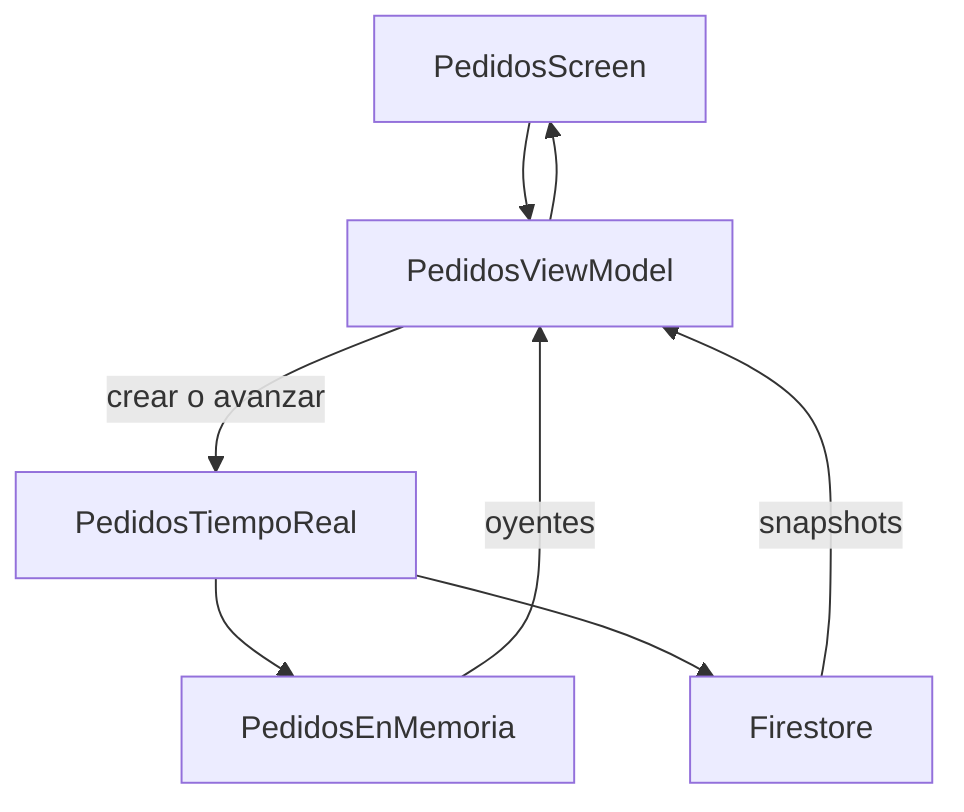

# Puesto vivo

La cola de pedidos de un puesto. Un plato vacío no entra, y quien observa la cola se entera sin recargar.

## Concepto

El pedido nace `pendiente`, pasa a `preparando` y termina `listo`. El view model se suscribe a un puerto de tiempo real. En las pruebas ese puerto es memoria: cada guardado avisa a los oyentes. Firestore es el otro adaptador, para cuando exista un proyecto de Firebase.

## Stack

| Pieza | Para qué |
| --- | --- |
| React Native CLI | `PedidosScreen` es la pantalla nativa. |
| TypeScript | Dominio, datos y view model, probados con `node:test`. |
| MVVM | `PedidosViewModel` guarda el estado y avisa a la pantalla. |
| Inyección de dependencias | `armarPuesto` une el repositorio y el view model. |
| Tiempo real | `observar` empuja la lista en cada cambio. |
| Firebase Firestore | `src/data/firebase.ts`, el adaptador remoto. |
| CRUD | Crear, avanzar y listar pedidos. |

## Flujo



## Correr

Desde esta carpeta:

```bash
npm test
```

Para el cascarón nativo se genera un proyecto con `npx @react-native-community/cli init PuestoVivo` y se copia `src/` dentro.
